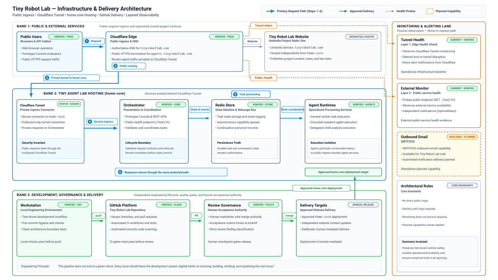

# Tiny Robot Lab Infrastructure and Delivery Architecture

This document describes the infrastructure topology, request ingress, hosting boundaries, delivery workflow, and layered observability architecture for Tiny Robot Lab and Tiny Agent Lab.

## 1. System Architecture Overview

The system architecture organizes operational paths and boundaries into three tiers:

1. **Public and External Services**: Internet-facing entry points, authoritative DNS routing, and the separately hosted umbrella website.
2. **Tiny Agent Lab Hosting (`home-core`)**: Physical on-premises server hosting containerized agents, orchestrator, and persistence behind an authenticated outbound tunnel.
3. **Development, Governance, and Delivery Lifecycle**: Developer workstation, GitHub repository, automated CI/security gates, human acceptance governance, and approved release delivery.

A dedicated **Monitoring and Alerting Lane** operates passively alongside these tiers, ensuring observability remains decoupled from primary request handling.

*Figure 1: Tiny Robot Lab infrastructure topology, primary numbered request path (Steps 1–6), development delivery lifecycle, and layered observability.*

## 2. Public Request Path

The documented public request path reaches Tiny Agent Lab through Cloudflare and Cloudflare Tunnel:

1. **Step 1 — Public Ingress Request**: A client browser or evaluator submits an HTTPS request to [agents.tinyrobotlab.com](https://[agents.tinyrobotlab.com](https://agents.[tinyrobotlab.com](https://tinyrobotlab.com) (Prototype Console UI or REST API).
2. **Step 2 — Cloudflare Edge Processing**: Cloudflare Edge provides authoritative DNS routing for `tinyrobotlab.com`, terminates public HTTPS, and directs agent traffic privately to Cloudflare Tunnel.
3. **Step 3 — Encrypted Tunnel Transit**: Cloudflare Tunnel carries the encrypted request privately from Cloudflare Edge to `home-core`.
4. **Step 4 — Host Ingress and Reverse Proxy**: Cloudflare Tunnel on `home-core` forwards the request locally to Orchestrator.
5. **Step 5 — Task Execution and Coordination**: Orchestrator validates request schemas, checks capability routes, records state in Redis Store, and coordinates task execution across Agent Runtimes (`worker`, `research-agent`, `analysis-agent`).
6. **Step 6 — Protected Response Return**: Response returns through the same protected path back to the client.

### Secondary Public Path: Separately Hosted Website

Traffic intended for [tinyrobotlab.com](https://[tinyrobotlab.com](https://tinyrobotlab.com) resolves to an independent static host. This secondary path does not enter `home-core` and is not part of the numbered agent request flow.

## 3. Hosting Boundaries

### Separation Between Website and `home-core`

The umbrella website [tinyrobotlab.com](https://[tinyrobotlab.com](https://tinyrobotlab.com) and Tiny Agent Lab [agents.tinyrobotlab.com](https://[agents.tinyrobotlab.com](https://agents.[tinyrobotlab.com](https://tinyrobotlab.com) maintain distinct operational and physical hosting boundaries:

- **Tiny Robot Lab Website**: Hosted on an independent static platform at [tinyrobotlab.com](https://[tinyrobotlab.com](https://tinyrobotlab.com) to publish project context, notes, and lab links. The website does not participate in Tiny Agent Lab task execution or state management. Routine website updates do not require changes to the Tiny Agent Lab deployment on `home-core`, and Tiny Agent Lab runtime activity is not served by the website host.
- **Tiny Agent Lab (`home-core`)**: Hosted on an on-premises physical server running containerized subsystem services defined in `compose.yaml` (Cloudflare Tunnel, Orchestrator, Redis Store, and Agent Runtimes).

### Cloudflare Edge versus Cloudflare Tunnel

- **Cloudflare Edge**: Public entry point providing DNS resolution, certificate termination, and ingress routing.
- **Cloudflare Tunnel**: Authenticated outbound-only tunnel daemon running on `home-core`. Because the connection originates outbound from the host, `home-core` serves no direct public origin traffic.

## 4. Development, Governance, and Delivery Path

Development and delivery follow an independent engineering lifecycle strictly separated from public request traffic:

1. **Local Test-Driven Development**: Engineers work locally on feature branches, validating changes in a local virtual environment with pre-commit hygiene checks.
2. **GitHub Repository and Automated CI**: Pull requests to `Tiny-Robot-Lab/autonomous-agent-lab` trigger automated GitHub Actions workflows, executing test suites, linting, and automated security code scanning.
3. **Review Governance and Human Acceptance Gate**: Acceptance criteria are frozen at kickoff per `AGENTS.md`. The human maintainer remains the sole acceptance and merge authority.
4. **Approved delivery targets**:
   - **Approved `home-core` deployment**: Approved releases on `main` are delivered to `home-core` through a deliberate, human-mediated release pull and service restart.
   - **Website content delivery**: Static documentation updates are delivered independently to the website host.

## 5. Monitoring and Alerting Architecture

Observability operates in a dedicated passive lane alongside runtime services:

### Layer 1: Tunnel Health (Current and verified)

- **Scope**: Observes connectivity between Cloudflare Edge and Cloudflare Tunnel on `home-core`.
- **Behavior**: Detects tunnel or host reachability disruptions.
- **Alerting**: Cloudflare dispatches operational notifications directly through its own alerting channel.

### Layer 2: External Service Monitor (Current and verified)

- **Status**: Current and verified via controlled failure and recovery testing (five-minute polling interval via UptimeRobot).
- **Alerting**: Dispatches independent email notifications directly through UptimeRobot upon detected downtime or recovery; alerts do not flow through SMTP2GO. External monitoring observes public reachability and does not participate in request processing or diagnose internal failure causes.

#### Tiny Agent Lab Lookout

Public availability observation for Tiny Agent Lab.

#### Tiny Agent Lab Pulse

`GET`-based keyword monitoring of `https://agents.tinyrobotlab.com/health` checking for `"status":"ok"`. An initial standard HTTP monitor sent `HEAD` to `/health`, which accepts `GET` and returned HTTP 405 Method Not Allowed (a monitor-method mismatch rather than an application outage), so Pulse was configured as a `GET` keyword monitor.

#### Tiny Robot Lab Beacon

External availability observation for the separately hosted Tiny Robot Lab website.

#### Controlled Validation Summary

- **Polling interval**: UptimeRobot polls at a five-minute interval; exact outage-detection or recovery latency is intentionally not characterized because transitions may occur anywhere within that interval.
- **Controlled application-down**: Stopping the Orchestrator while Cloudflare Tunnel remained running caused external monitoring to report the service down and send a down email while Layer 1 tunnel availability remained intact; restarting the Orchestrator restored `Up` status and triggered a recovery email.
- **Controlled tunnel-down**: Stopping Cloudflare Tunnel while Tiny Agent Lab remained running locally on `home-core` triggered a Cloudflare tunnel-down notification followed by external down detection and notification from UptimeRobot; restarting the tunnel restored both layers with recovery notifications (a transient DNS-related error was observed during public-path recovery before `/health` became reachable again, without inferring a root cause).
- **Final recovery evidence (`2026-11-24T06:38:49+00:00`)**: All Tiny Agent Lab Compose services were running, Orchestrator and Redis reported healthy, and public `GET https://agents.tinyrobotlab.com/health` returned `{"status":"ok"}`.

### Outbound Email Gateway: SMTP2GO (Available / Planned)

- **Scope**: Transactional outbound email capability for Tiny Robot Lab.
- **Status**: Service available; automated notification delivery and lab-note distribution remain planned capabilities.
- **Boundary Clarification**: Layer 1 (Cloudflare) and Layer 2 (UptimeRobot) retain their own independent alert notification paths and are not relayed through SMTP2GO.

## 6. Current versus Planned Capabilities

Operational capabilities are explicitly classified by verified status:

| Capability / Component | Tier | Operational Status | Summary |
|---|---|---|---|
| `agents.tinyrobotlab.com` | Public Ingress | Current and verified | Live public endpoint for Prototype Console and REST APIs. |
| `tinyrobotlab.com` | Umbrella Site | Current and verified | Independent static hosting; separate origin. |
| Cloudflare Edge | Ingress and DNS | Current and verified | Authoritative DNS and public HTTPS termination. |
| Cloudflare Tunnel | Private Connector | Current and verified | Outbound tunnel daemon defined in `compose.yaml`. |
| `home-core` Services | Infrastructure | Current and verified | Container stack (Orchestrator, Redis Store, Agent Runtimes). |
| Tunnel Health (Layer 1) | Monitoring | Current and verified | Operational Cloudflare tunnel health alerts. |
| External Service Monitor (Layer 2) | Monitoring | Current and verified | UptimeRobot external probes including `GET` `/health` keyword check at five-minute intervals. |
| Outbound Email Gateway (SMTP2GO) | Email / Alerting | Available / Planned | Outbound service available; automated pipeline planned. |
| Approved `home-core` Deployment | Delivery | Current and verified | Deliberate, human-mediated deployment process. |

## 7. Security and Privacy Boundaries

This section defines the documentation scope and architectural boundaries of the system:

1. **Documented Public Path**: The documented request path reaches Tiny Agent Lab through Cloudflare and Cloudflare Tunnel. This architecture does not depict `home-core` as a direct public web origin.
2. **Segregated Delivery Path**: GitHub development and CI processes remain isolated from public runtime request processing.
3. **Passive Observability**: Monitoring probes observe service health externally and never gate task execution.
4. **Boundary Isolation**: Public endpoints expose bounded task contracts and the Prototype Console UI. This document does not expose internal coordination, store contents, credentials, or private network details.
5. **Bounded Claims**: Operational documentation reflects verified repository evidence and supplied context without assuming unconfigured automation.

## 8. Engineering Principle

All architectural decisions across Tiny Robot Lab and Tiny Agent Lab are guided by our core engineering principle:

> **The pipeline does not end at a green check. Every issue should leave the development system slightly better at choosing, building, verifying, and explaining the next issue.**

Passing automated tests provides evidence that the tested invariants remain satisfied. A complete engineering increment requires verifying runtime behavior across deployment boundaries, maintaining transparent documentation of current versus planned capabilities, and upholding clean architectural boundaries.
